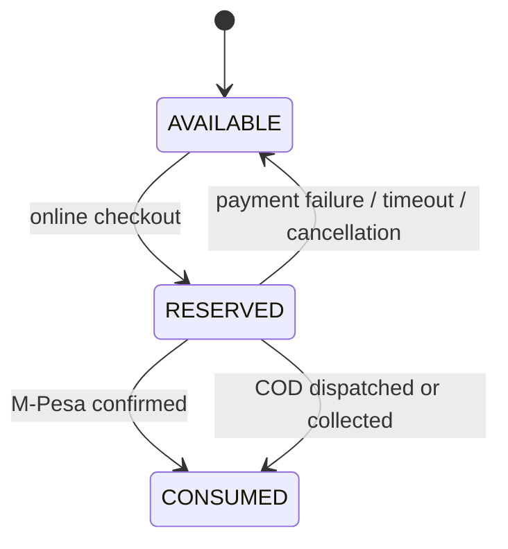
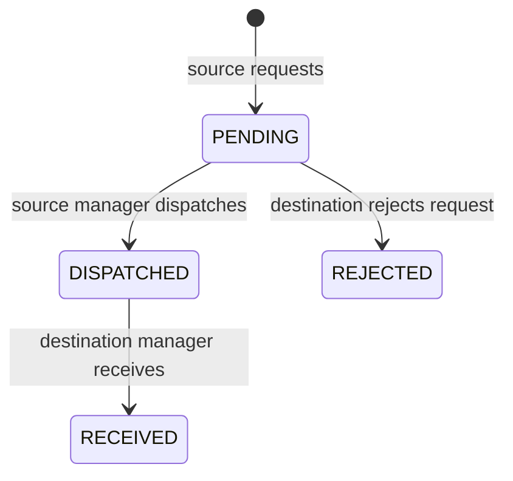

# Phase 1.5 — Inventory State and Role-Scope Resolution

## Decisions implemented

- Inventory managers are branch-bound.
- `Stock.quantity` remains the physical sellable on-hand balance for backward API compatibility.
- `available_quantity = quantity - reserved_quantity`.
- Online checkout reserves stock instead of immediately deducting physical on-hand.
- Successful M-Pesa settlement consumes both the reservation and on-hand stock.
- Failed or expired payment releases the reservation without inflating on-hand stock.
- COD delivery consumes its reservation when dispatched; COD pickup consumes it when collected.
- Approved customer returns enter damaged/quarantine stock and are not immediately resold.
- Transfers now have distinct `PENDING → DISPATCHED → RECEIVED` states.

## Stock balances

| Field | Meaning | Sellable? |
|---|---|---:|
| `quantity` | Physical sellable-condition units currently on hand, including reservations | Partially |
| `reserved_quantity` | Portion of on-hand committed to open orders | No |
| `available_quantity` | Computed `quantity - reserved_quantity` | Yes |
| `in_transit_quantity` | Units dispatched from this branch but not received | No |
| `damaged_quantity` | Returned/damaged units in quarantine | No |

`physical_custody_quantity` is a reporting helper equal to on-hand plus outbound in-transit plus damaged stock. It must not be used as availability.

## Order inventory lifecycle

Every reservation, release, and consumption has an audit row and an idempotency key based on branch, catalog item, movement reason, and order number.

## Transfer lifecycle

At dispatch, source on-hand decreases and source in-transit increases. At receipt, source in-transit decreases and destination on-hand increases. No destination stock is created before confirmed receipt.

API workflow:

1. `POST /api/inventory/transfers/`
2. `POST /api/inventory/transfers/{id}/dispatch/`
3. `POST /api/inventory/transfers/{id}/confirm/`

The existing `confirm` URL is retained but now means receipt confirmation and requires `DISPATCHED` state.

## Migration behaviour

- Historic `CONFIRMED` transfers become `RECEIVED`.
- Legacy pending M-Pesa orders are converted from immediate deductions into reservations.
- Legacy COD orders still awaiting dispatch/collection are converted into reservations.
- Already-paid M-Pesa and already-dispatched COD inventory remains consumed.
- Migration is blocked if role/branch data violates the new database constraint.

## Remaining certification limitation

SQLite tests validate calculations, rollback, constraints, and idempotent sequential retries. A two-writer overselling test is included and automatically skipped when the database lacks `SELECT FOR UPDATE`; it must pass in PostgreSQL CI before production approval.
