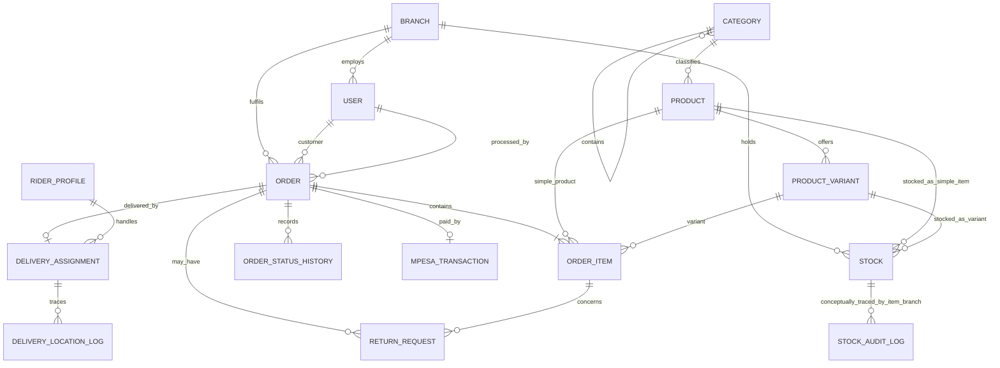

# Domain Model and Data Dictionary

## Core relationship map

`StockAuditLog` intentionally stores branch plus product/variant rather than a foreign key to `Stock`, so historic movement survives stock-row lifecycle changes.

## Entity ownership

| Entity | Source of truth | Key invariants |
|---|---|---|
| `Branch` | branches | Unique physical location name; inactive branches cannot accept new online checkout. |
| `User` | users | Unique phone; optional unique email; staff and branch managers require a branch; customer and super-admin cannot retain a branch. |
| `Category` | catalog | Unique name/slug; self-referencing hierarchy. Cycle prevention is not yet enforced. |
| `Product` | catalog | Unique slug/SKU; base price. Non-negative price is not yet a DB constraint. |
| `ProductVariant` | catalog | Unique `(product, attribute_name, attribute_value)`; optional price override. |
| `Stock` | inventory | Exactly one of product/variant; unique item per branch; non-negative quantity. |
| `StockAuditLog` | inventory | Append-only by service convention; records delta and resulting balance. Database immutability is not enforced. |
| `TransferRequest` | inventory | Exactly one item; positive quantity; source and destination differ; explicit workflow state. |
| `Order` | orders | Unique order number; non-negative financials; discount cannot exceed subtotal; status changed through transition service. |
| `OrderItem` | orders | Exactly one product/variant; positive quantity; non-negative locked unit/total prices. |
| `OrderStatusHistory` | orders | Append-only lifecycle evidence by service convention. Database immutability is not enforced. |
| `MpesaTransaction` | payments | One per order; unique checkout/merchant identifiers and receipt; amount is null or non-negative. |
| `DeliveryZone` / `PickupSlot` | logistics | Branch-owned fulfilment configuration. |
| `RiderProfile` | logistics | One per user; belongs to one branch; duty status independent from user role. |
| `DeliveryAssignment` | logistics | One per order; assigned rider must match order branch. |
| `Coupon` / `FlashSale` | marketing | Promotion configuration. Several date/value rules still rely on service validation. |
| `ReturnRequest` | marketing | Item-level return request. Approved quantity aggregation and refund ledger are not yet complete. |

## Inventory semantics — current truth

Phase 1.5 added explicit on-hand, reserved, in-transit, and damaged/quarantine balances. `available_quantity` is computed as on-hand minus reserved. Online checkout reserves, payment/fulfilment consumes, cancellation releases, transfer dispatch moves units into transit, and approved returns enter quarantine. See [Phase 1.5](../phase-1-5/README.md).

## Financial semantics

- `OrderItem.unit_price` is the purchase-time price snapshot.
- `OrderItem.total_price` is set to `unit_price × quantity` by model code; the database currently enforces only non-negativity, not the multiplication equality.
- `Order.subtotal` is the sum before order discount and delivery fee.
- `Order.total_payable` is expected to be `subtotal - discount_amount + delivery_fee`. Service code computes it, but exact equality is not yet a database constraint.
- Payment confirmation rejects an M-Pesa callback whose amount differs from `total_payable`.
