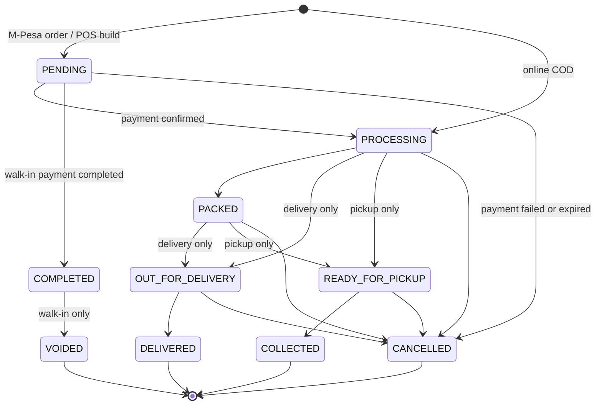
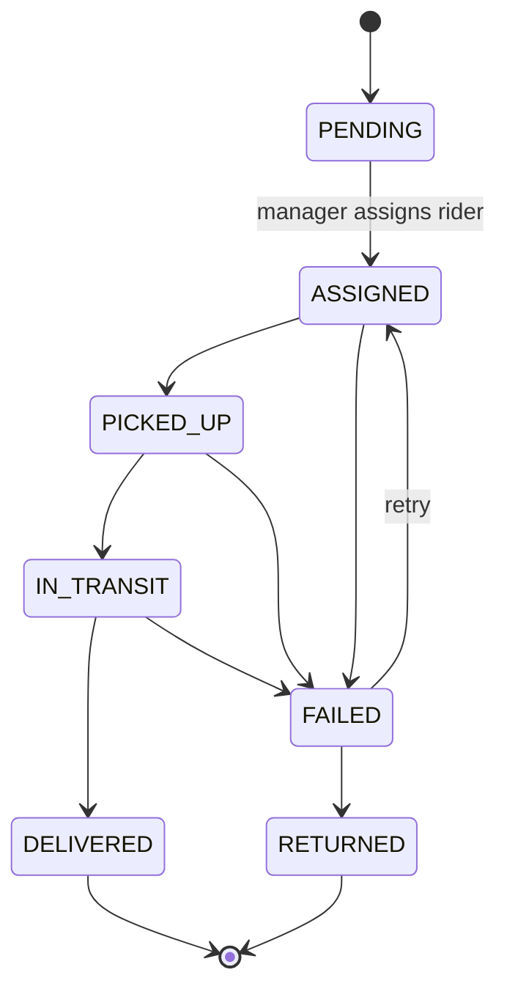
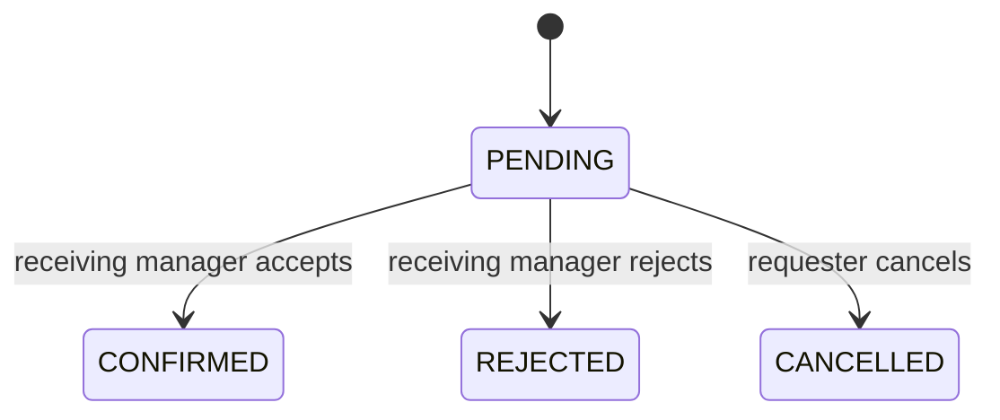

# State Machines

## Order lifecycle

All persisted changes after order creation must use `orders.transitions.OrderTransitionService`. It obtains a row lock, validates order type and current state, writes the order, and creates `OrderStatusHistory` in one transaction.

`PAYMENT_CONFIRMED` remains in the legacy enum but is not used by the active flow. It should be removed only after checking production data and API consumers.

## Delivery assignment lifecycle

A delivery `FAILED` state is not an order cancellation. A later returns/refunds phase must define what `RETURNED` does to payment, stock custody, and customer communication.

## Transfer lifecycle

Confirmation deducts from the source and adds to the destination atomically, with two stock audit entries.

